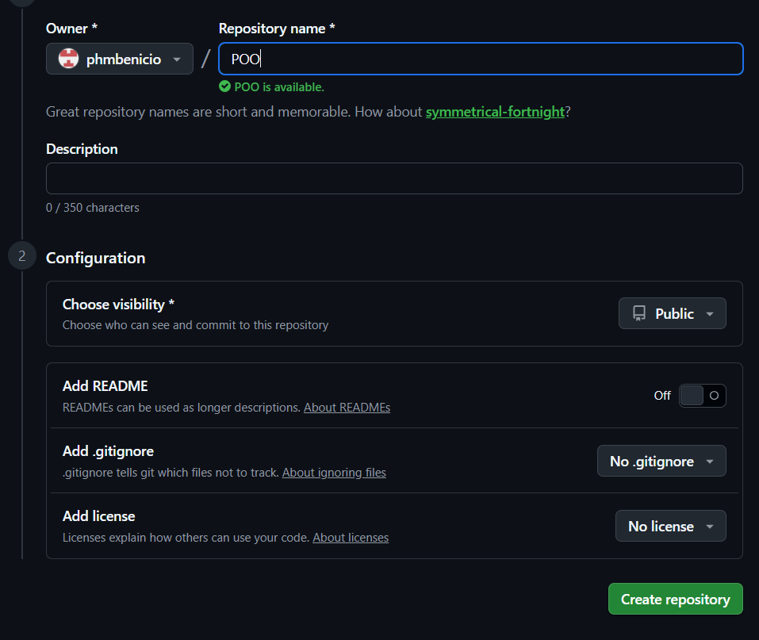
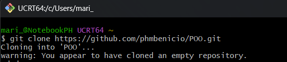
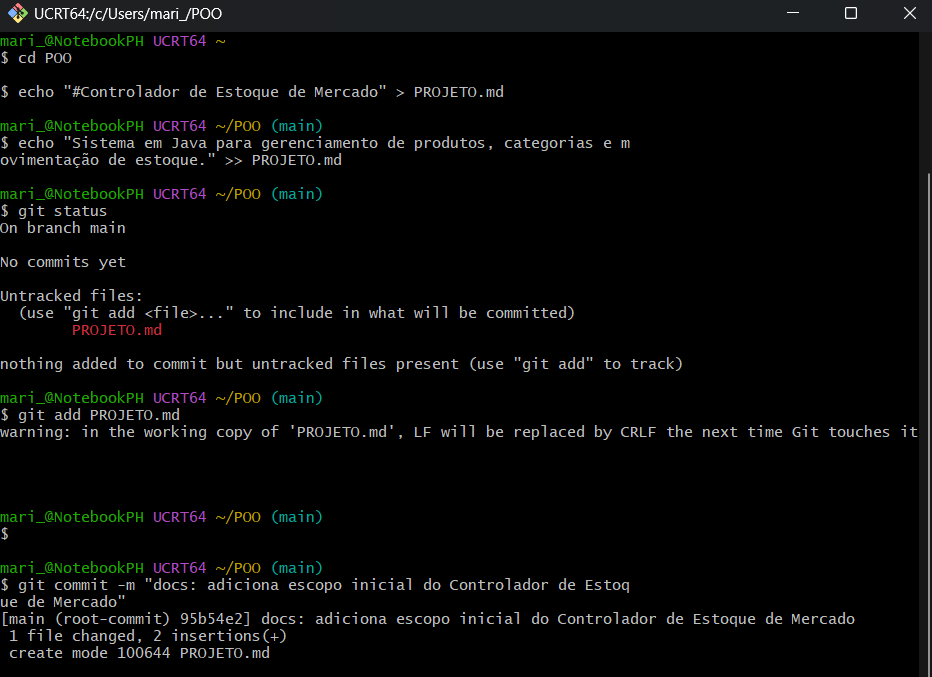
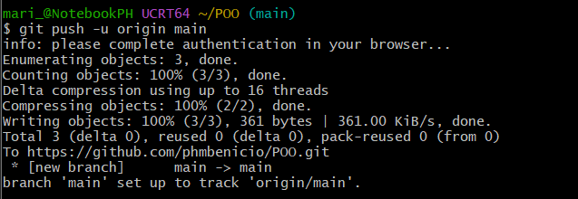
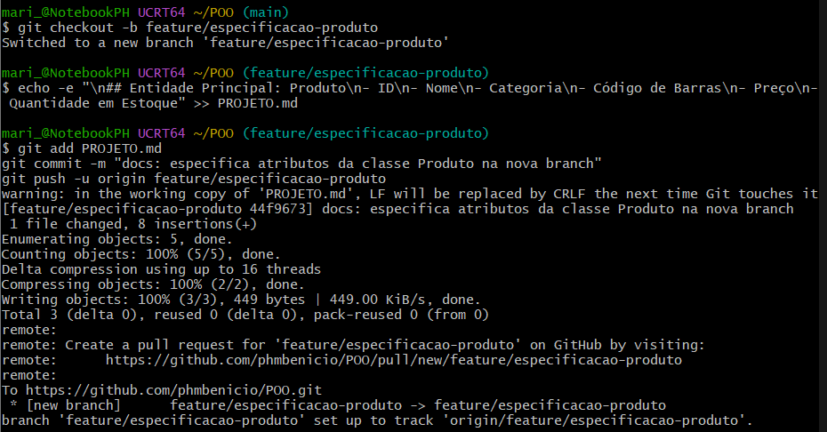
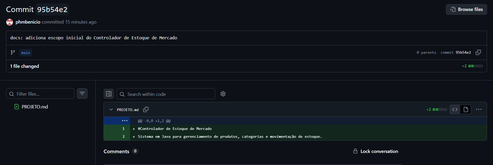
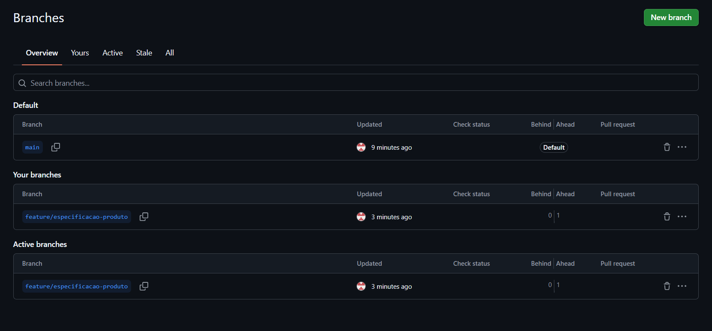

*Nome: Pedro Henrique Machado Benício*  
*Matrícula: 202600677*

# 1) Criação do repositório

Para iniciar a atividade prática de controle de versões e dar continuidade à ideia de um programa de controle de estoque de um mercado, criei um repositório público chamado POO na minha conta pessoal do GitHub (phmbenicio), mantendo as opções iniciais desmarcadas para realizar a configuração pelo terminal.

## Repositório Criado no GitHub



# 2) Clonagem

Com o repositório criado remotamente, utilizei o comando git clone no terminal Git Bash para criar uma cópia local do repositório na minha máquina.

```bash
git clone [https://github.com/phmbenicio/POO.git](https://github.com/phmbenicio/POO.git)
```

## Execução do Comando git clone



# 3) Edição e versionamento

Entrei na pasta do repositório com o comando cd POO e criei o arquivo PROJETO.md utilizando o comando echo, adicionando o título e uma breve descrição do sistema em Java para gerenciamento de produtos, categorias e movimentação de estoque.

Em seguida, verifiquei o estado do repositório com git status, adicionei o arquivo criado com git add, registrei a alteração com git commit e enviei para a branch principal (main) no GitHub utilizando o comando git push.

```bash
cd POO
echo "#Controlador de Estoque de Mercado" > PROJETO.md
echo "Sistema em Java para gerenciamento de produtos, categorias e movimentação de estoque." >> PROJETO.md
git status
git add PROJETO.md
git commit -m "docs: adiciona escopo inicial do Controlador de Estoque de Mercado"
git push -u origin main
```

## Criação do Arquivo e Commit Local



## Envio para o GitHub (git push)



# 4) Criação e alteração de ramo (branch)

Utilizei o comando git checkout -b para criar um novo ramo chamado feature/especificacao-produto e alternar para ele imediatamente.

Nesse novo ramo, modifiquei o arquivo PROJETO.md adicionando os atributos da entidade principal Produto (ID, Nome, Categoria, Código de Barras, Preço e Quantidade em Estoque). Depois, preparei a modificação com git add, registrei um novo commit e enviei o ramo para o repositório remoto com git push.

```bash
git checkout -b feature/especificacao-produto
echo -e "\n## Entidade Principal: Produto\n- ID\n- Nome\n- Categoria\n- Código de Barras\n- Preço\n- Quantidade em Estoque" >> PROJETO.md
git add PROJETO.md
git commit -m "docs: especifica atributos da classe Produto na nova branch"
git push -u origin feature/especificacao-produto
```

## Criação da Branch, Commit e Push



# 5) Evidências do histórico de commits e dos ramos no GitHub

Abaixo estão as capturas de tela diretamente da interface do GitHub comprovando o registro do histórico de commits e a existência dos dois ramos (main e feature/especificacao-produto) no repositório remoto.

## Histórico de Commit no GitHub



## Ramos (Branches) no GitHub


